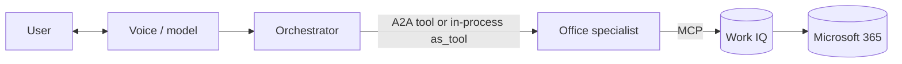

# Qubix — Voice orchestrator + Office specialist (Work IQ)

Proof of concept for a **voice-first assistant** that answers Microsoft 365
questions. An **orchestrator** keeps the conversation and delegates Office
questions (mail, calendar, Teams, files) to an **Office specialist** that reaches
Microsoft 365 through the **Work IQ MCP** server.

The repo has four builds of the same idea, plus notes on the one thing that
actually decides the design: **identity**.

## Read this first — what we learned about identity

Work IQ is a **delegated** service: it acts on behalf of the signed-in user and
requires that user to hold a **Microsoft 365 Copilot license**. That single fact
drives the whole design:

- A voice turn has **no browser**, so it cannot complete an **interactive OAuth
  consent**. Any design that needs the user to sign in *during* the turn is stuck.
  Voice Live states this plainly: it "does not support interactive OAuth
  authorization for MCP tools".
- Exposing the specialist over **A2A works**. The "Agent card path" 400 that is
  easy to chase is configuration dependent, **not** the real blocker. The real
  wall is the interactive consent the delegated connector asks for one step later.
- The pattern that works: the **app acquires the user's Work IQ token out of band**
  (a normal sign-in, once, before the conversation) and then calls Work IQ as that
  user. No interactive OAuth in the turn, and the identity flows the whole way.
- Without a Copilot license the Work IQ call comes back **Forbidden**, no matter
  how the plumbing is wired.

Approach **C** and the **web app** below implement this working pattern.

## The four builds

| | A — agent mode | B — model mode | C — Agent Framework | Web app |
|---|---|---|---|---|
| Voice brain | `gpt-5` agent + Voice Live | `gpt-realtime-1.5` | `gpt-5` via MAF (text CLI) | `gpt-realtime` in the browser |
| Orchestrator → specialist | native **A2A tool** | function tool → A2A client | **in-process** (`agent.as_tool`) | function tool in the backend |
| Specialist → Work IQ | specialist's Foundry MCP connection | same | **native MCP** with the user's token | backend MCP with the user's token |
| Identity to Work IQ | server-side (hits the consent) | server-side | **user token, out of band** | **user token, out of band** |
| Folder | [`approach_a_agent_mode/`](approach_a_agent_mode/) | [`approach_b_model_mode/`](approach_b_model_mode/) | [`approach_c_agent_framework/`](approach_c_agent_framework/) | [`webapp/`](webapp/) |

Approaches A and B keep the original A2A design and are great for showing the
architecture, but they hit the interactive-consent wall because the specialist
reaches Work IQ server-side. Approach C (Microsoft Agent Framework, in-process)
and the web app hold the user's token out of band, which is what makes the voice
flow viable.



## Prerequisites

- **Azure CLI** signed in: `az login` (an account with the **Foundry User** /
  **Cognitive Services User** role on the project). This authenticates the model
  and agent calls.
- A **Foundry project** with `gpt-5` and `gpt-realtime-1.5` deployed.
- A **Microsoft 365 Copilot license** on any account that will actually query
  Work IQ. Without it, Work IQ returns `Forbidden`.
- An **Entra app registration** with the `WorkIQAgent.Ask` delegated permission:
  - Approaches A/B and the web app use it for the Work IQ connection and the
    browser sign-in (SPA redirect `http://localhost:3000`).
  - Approach C signs in with the **device-code** flow, which needs the app to have
    **"Allow public client flows"** enabled:
    `az ad app update --id <CLIENT_ID> --set isFallbackPublicClient=true`.
- **Python 3.10+** for the setup scripts and approaches A/B/C.
- **Node.js** (rebuild the devcontainer) for the web app frontend.

## Configure

```bash
cp .env.example .env
# then fill in the values (see comments in the file)
```

## Where to run what

- **Setup scripts**, **Approach C**, and the **web app** run in the devcontainer
  (no host microphone needed).
- The **voice clients of Approaches A and B need a real microphone and speakers**.

> ⚠️ **Docker Desktop on Windows/macOS cannot pass the host microphone into a
> container.** Run the Approach A/B voice clients **natively on your Windows host**
> (Python + `pip install -r <approach>/requirements.txt`). The web app sidesteps
> this because the microphone lives in the browser, not the container.

## Steps

### 1. Create the Work IQ MCP connection

The specialist needs a Work IQ connection. The connect dialog in Foundry asks for
an OAuth client (client id + secret). Register that Entra app with the helper
script, then paste the printed values into the portal dialog:

```bash
bash setup/register_workiq_app.sh
```

It registers the app, adds the `WorkIQAgent.Ask` permission, creates a secret and
grants admin consent, then prints everything for the **Connect the Work IQ MCP
tool** dialog. In the portal, open your project → add the Work IQ MCP tool, paste
the values, and click **Connect**. The connection name (`WorkIQMCP`) and endpoint
are already set in `.env`.

> The client secret goes **only** into the Foundry dialog — never into `.env` or git.
> If the connect step fails with `AADSTS50011` (redirect mismatch), copy the
> `redirect_uri` from the error and run
> `az ad app update --id <CLIENT_ID> --web-redirect-uris <URI>`.

### 2. Create the specialist (shared, in the devcontainer)

```bash
pip install -r requirements.txt
python setup/create_specialist_agent.py
```

This creates the specialist with the Work IQ MCP tool and enables incoming A2A.

### 3a. Approach A — agent mode

```bash
# In the devcontainer: create the orchestrator + A2A connection
python approach_a_agent_mode/create_orchestrator_agent.py

# On your Windows host: talk to it
pip install -r approach_a_agent_mode/requirements.txt
python approach_a_agent_mode/voice_orchestrator.py
```

### 3b. Approach B — model mode

```bash
# On your Windows host (no orchestrator agent to create for this approach)
pip install -r approach_b_model_mode/requirements.txt
python approach_b_model_mode/voice_orchestrator.py
```

### 3c. Approach C — Microsoft Agent Framework (in-process)

Runs entirely in the devcontainer. It is a text CLI, but the identity pattern is
exactly the one the voice web app uses. It builds both agents in one process,
signs the user in out of band with a device code, and reaches Work IQ through the
framework's **native MCP** tool.

```bash
pip install -r approach_c_agent_framework/requirements.txt
az login                       # into the Foundry tenant (for the model calls)
python approach_c_agent_framework/run_test.py
```

Details in [`approach_c_agent_framework/README.md`](approach_c_agent_framework/README.md).

### 3d. Web app — the working voice end-to-end

The browser does the microphone and the MSAL sign-in; the backend bridges the
audio to Voice Live and calls Work IQ as the signed-in user. Full instructions in
[`webapp/README.md`](webapp/README.md).

## Notes

- Approaches A and B reach Work IQ **server-side** (the specialist's own Foundry
  connection), so they hit the interactive-consent wall in a voice turn. Approach
  C and the web app hold the user's token **out of band**, which is the viable
  pattern for voice.
- Every user who queries Work IQ needs a **Microsoft 365 Copilot license**, or the
  call returns `Forbidden`.
- MCP approvals are set to `never` so the voice flow is smooth. For production,
  require approval for tools that write or change data.
- Conversation logs are written to a `logs/` folder next to each voice client.
