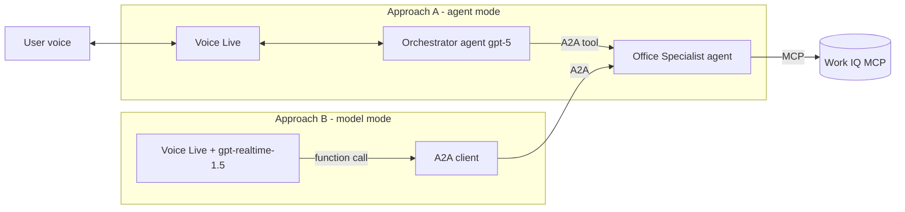

# Qubix — Voice Orchestrator + Office Specialist (A2A) PoC

A proof of concept with two agents:

- **Orchestrator** — voice-first agent (Azure Voice Live). You talk to it.
- **Office Specialist** — Foundry agent connected to the **Work IQ MCP** server,
  exposed as an **A2A** endpoint so the orchestrator can ask it Microsoft Office /
  Microsoft 365 questions.

The specialist is shared. The orchestrator is provided in **two approaches** so you
can compare them:

| | Approach A — agent mode | Approach B — model mode |
|---|---|---|
| Voice brain | `gpt-5` Foundry agent + Voice Live for audio | `gpt-realtime-1.5` directly (lower latency) |
| Reaches specialist via | Native **A2A tool** on the orchestrator agent | Voice Live **function tool** → A2A client |
| Folder | [`approach_a_agent_mode/`](approach_a_agent_mode/) | [`approach_b_model_mode/`](approach_b_model_mode/) |



## Prerequisites

- Azure CLI signed in: `az login` (account with the **Foundry User** role on the project).
- A Foundry project with `gpt-5` and `gpt-realtime-1.5` deployed.
- A **Work IQ** connection in the Foundry project. It uses OAuth, so it needs an
  Entra app (client id + secret) with the `WorkIQAgent.Ask` permission. Use the
  helper script below to create that app, then complete the portal dialog.
  Requires a **Microsoft 365 Copilot** license.
- Python 3.10+.

## Configure

```bash
cp .env.example .env
# then fill in the values (see comments in the file)
```

## Where to run what

The **setup scripts create agents and need no audio** → run them in the devcontainer.
The **voice clients need a microphone and speakers**.

> ⚠️ **Docker Desktop on Windows/macOS cannot pass the host microphone into a
> container.** Run the voice clients **natively on your Windows host** (Python +
> `pip install -r <approach>/requirements.txt`). The devcontainer is only for the
> setup scripts.

## Steps

### 1. Create the Work IQ MCP connection

The specialist needs a Work IQ connection. The connect dialog in Foundry asks for
an OAuth client (client id + secret). Register that Entra app with the helper
script, then paste the printed values into the portal dialog:

```bash
bash setup/register_workiq_app.sh
```

It registers the app, adds the `WorkIQAgent.Ask` permission, creates a secret and
grants admin consent, then prints everything for the **Connect the Work IQ MCP
tool** dialog. In the portal, open your project → add the Work IQ MCP tool, paste
the values, and click **Connect**. The connection name (`WorkIQMCP`) and endpoint
are already set in `.env`.

> The client secret goes **only** into the Foundry dialog — never into `.env` or git.
> If the connect step fails with `AADSTS50011` (redirect mismatch), copy the
> `redirect_uri` from the error and run
> `az ad app update --id <CLIENT_ID> --web-redirect-uris <URI>`.

### 2. Create the specialist (shared, in the devcontainer)

```bash
pip install -r requirements.txt
python setup/create_specialist_agent.py
```

This creates the specialist with the Work IQ MCP tool and enables incoming A2A.

### 3a. Approach A — agent mode

```bash
# In the devcontainer: create the orchestrator + A2A connection
python approach_a_agent_mode/create_orchestrator_agent.py

# On your Windows host: talk to it
pip install -r approach_a_agent_mode/requirements.txt
python approach_a_agent_mode/voice_orchestrator.py
```

### 3b. Approach B — model mode

```bash
# On your Windows host (no orchestrator agent to create for this approach)
pip install -r approach_b_model_mode/requirements.txt
python approach_b_model_mode/voice_orchestrator.py
```

## Notes

- MCP approvals are set to `never` so the voice flow is smooth. For production,
  require approval for tools that write or change data.
- Conversation logs are written to a `logs/` folder next to each voice client.
