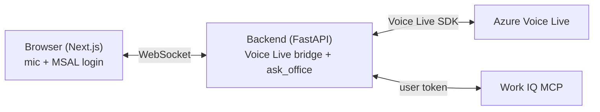

# Qubix Voice web app (the real end-to-end PoC)

Voice-first assistant that reaches Microsoft 365 through **Work IQ as the
signed-in user** — the pattern our tests proved is the viable one for voice:

- The **browser** does the microphone/speaker and the **MSAL sign-in** (so the
  user's delegated Work IQ token is acquired *out of band*, not during a voice turn).
- The **backend** bridges the browser to **Voice Live** (model mode, gpt-realtime)
  and, when the model calls `ask_office`, queries **Work IQ with the user's token**.

No interactive OAuth during the voice turn, no A2A, no preview bug.



## Prerequisites

- Rebuild the devcontainer so **Node** is available (added in `.devcontainer/devcontainer.json`).
- `az login` (the backend uses your identity for Voice Live; you need the
  **Cognitive Services User** role on the Foundry resource).
- The app registration already has the SPA redirect `http://localhost:3000` and
  the `WorkIQAgent.Ask` permission (configured during setup).
- Values in the repo `.env`: `VOICELIVE_ENDPOINT`, `REALTIME_MODEL`, `VOICE_NAME`,
  `TENANT_ID`, `CLIENT_ID`, `WORKIQ_SCOPE`.

## Run

Two terminals in the devcontainer.

**Backend** (port 8000):

```bash
cd webapp/backend
pip install -r requirements.txt
uvicorn app:app --host 0.0.0.0 --port 8000
```

**Frontend** (port 3000):

```bash
cd webapp/frontend
npm install
npm run dev
```

Open http://localhost:3000 in your browser (forwarded from the container):

1. **Sign in** — Microsoft sign-in popup (this is the out-of-band consent).
2. **Start talking** — allow the microphone.
3. Ask an Office/Microsoft 365 question (for example, about your recent mail or
   calendar). The model calls `ask_office`, the backend queries Work IQ as you,
   and the answer is spoken back.

## Files

- [backend/app.py](backend/app.py) — FastAPI WebSocket bridge to Voice Live + `ask_office` handler.
- [backend/workiq.py](backend/workiq.py) — minimal Work IQ MCP client (handshake, tools/list, tools/call).
- [frontend/app/page.js](frontend/app/page.js) — MSAL sign-in, Web Audio, WebSocket client.
- [frontend/public/capture-processor.js](frontend/public/capture-processor.js) / [playback-processor.js](frontend/public/playback-processor.js) — audio worklets (24 kHz PCM16).
